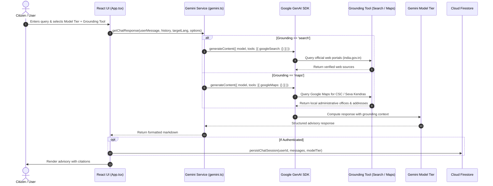

# SevaBot AI — Technical Design Document (TDD)

## 1. System Overview & Problem Statement

**SevaBot AI** is an intelligent, multilingual public service advisory platform designed to bridge the gap between Indian citizens and over 1,000+ Central and State welfare initiatives. 

Citizens frequently encounter barriers accessing public benefits due to:
- Complex administrative terminology and bureaucratic jargon.
- Information fragmentation across hundreds of disparate departmental portals.
- Linguistic barriers across 22+ constitutionally recognized regional languages.
- Low literacy rates requiring voice-first interaction modes.
- Difficulties locating physical enrollment kiosks (Common Service Centers and Seva Kendras).

SevaBot AI solves these challenges by combining **Google Gemini Multimodal Models**, **real-time bidirectional audio streaming**, **Google Search & Maps Grounding**, and **Firebase Firestore persistence** into a responsive web application.

---

## 2. High-Level Architectural Design

The platform follows a modern decoupled architecture:
- **Client Layer**: Single Page Application (SPA) built with React 19, TypeScript 5.8, Tailwind CSS v4, Motion (Framer Motion), and Lucide Icons.
- **AI & Grounding Layer**: Powered by `@google/genai` TypeScript SDK connecting to Google Gemini 4 Argon, 3.8 Flash, 3.1 Flash Lite, 3.8 Live, and 3.5 Transcribe.
- **Persistence & Identity Layer**: Firebase Authentication (Google OAuth provider) with Google Cloud Firestore (custom database instance) protected by granular security rules.
- **Audio Processing Pipeline**: Native HTML5 `AudioContext` (16kHz / 24kHz), `ScriptProcessorNode`, dynamic biquad filters, and `MediaRecorder` for audio capture.
- **Document Export Engine**: Dual PDF/TXT pipeline leveraging `html2canvas-pro` and `jsPDF`.

### System Architecture Diagram

```
+---------------------------------------------------------------------------------------------------------+
|                                           CITIZEN WEB CLIENT                                            |
|                               (React 19 + TypeScript + Tailwind CSS v4)                                 |
+---------------------------------------------------------------------------------------------------------+
    |                                   |                                     |                  |
    | [1] Multi-Turn Advisory           | [2] Live Voice Stream               | [3] Voice Mic    | [4] User Auth
    |     & Model Tier Selection        |     (WebSocket PCM Audio)           |     Recording    |     & Bookmarks
    v                                   v                                     v                  v
+-----------------------+     +-----------------------+     +-------------------+     +-------------------+
|   Gemini Model Tier   |     |    Gemini Live API    |     |  Gemini Audio     |     |   Firebase Auth   |
|   Routing Service     |     |      Service          |     |  Transcription    |     |    & Firestore    |
| (services/gemini.ts)  |     |  (services/gemini.ts) |     | (services/gemini) |     | (lib/firebase.ts) |
+-----------------------+     +-----------------------+     +-------------------+     +-------------------+
    |             |                         |                         |                         |
    |             |                         |                         |                         |
    | [A]         | [B]                     |                         |                         |
    v             v                         v                         v                         v
+-----------+ +-----------+       +-------------------+     +-------------------+     +-------------------+
|  Google   | |  Google   |       |  gemini-3.8-live  |     | gemini-3.5-       |     |  Google Cloud     |
|  Search   | |   Maps    |       | (Bidirectional    |     | transcribe        |     |  Firestore        |
| Grounding | | Grounding |       |  Live Voice)      |     | (Speech-to-Text)  |     |  (Persistent DB)  |
+-----------+ +-----------+       +-------------------+     +-------------------+     +-------------------+
    |             |                         |                         |                         |
    +------+------+                         |                         |                         |
           |                                |                         |                         |
           v                                v                         v                         |
+-------------------------------------------------------------------------------+               |
|                      Google Gemini Foundation Models                          |               |
|         • gemini-4-argon        : Complex policy & eligibility analysis       |<--------------+
|         • gemini-3.8-flash      : General inquiries & real-time grounding     | (Context Sync)
|         • gemini-3.1-flash-lite : Instant high-speed screening responses       |
+-------------------------------------------------------------------------------+
```

---

## 3. Gemini Model Tiers & Strategy Matrix

SevaBot adopts a multi-tier model selection architecture that matches inquiry depth with optimal latency and compute economics:

| Model Tier | Model Identifier | Primary Use Case | Grounding Capabilities | Latency Profile |
| :--- | :--- | :--- | :--- | :--- |
| **Complex Advisory** | `gemini-4-argon` | Multi-criteria legal qualification, landholding splits, tax thresholds, policy exceptions | Search Grounding compatible | Thorough (3-5s) with deep analysis |
| **General Advisory** | `gemini-3.8-flash` | Standard citizen guidance, scheme benefits, document checklists, FAQs | Search Grounding OR Maps Grounding | Balanced (1-2s) |
| **Fast Screening** | `gemini-3.1-flash-lite` | Quick eligibility yes/no checks, age limits, office hours, links | Standard prompts / Rapid lookup | Instant (<800ms) |
| **Real-time Voice** | `gemini-3.8-live` | Interactive spoken dialogue with natural back-and-forth speech & interruption | Real-time audio streaming | Sub-second streaming audio |
| **Transcription** | `gemini-3.5-transcribe` | Microphone audio speech recognition converting voice to text input | Audio Part base64 payload | Fast audio conversion |

### Grounding Mutual Exclusivity Rule
In accordance with Google GenAI SDK requirements, **`googleSearch` and `googleMaps` tools cannot be combined in a single request**. SevaBot enforces this at both UI and service level:
- When the citizen toggles **Search Grounding**, `{ googleSearch: {} }` is dispatched.
- When the citizen toggles **Maps Grounding**, `{ googleMaps: {} }` is dispatched.

---

## 4. End-to-End Data Flow Diagrams

### 4.1. Text Consultation & Grounding Flow (Sequence)



---

### 4.2. Real-Time Live Voice Streaming Architecture

The bidirectional Live audio connection operates over WebSockets:

```
[ Citizen Mic ] 
       │
       ▼ (16kHz PCM Float32)
[ ScriptProcessorNode / AudioContext ]
       │
       ▼ (Float32 to Int16 Conversion & Base64 Encoding)
[ liveSession.sendRealtimeInput({ audio: { data, mimeType: 'audio/pcm;rate=16000' } }) ]
       │
       ▼ (WebSocket Stream)
[ Gemini 3.8 Live API Server ]
       │
       ▼ (24kHz Raw PCM Audio Chunks)
[ playbackQueueRef & AudioContext Scheduler ]
       │
       ▼ (Dynamic High-Pass Biquad Filter & GainNode)
[ Citizen Audio Speakers / Headphones ]
```

**Interruption Handling**:
When the server emits `message.serverContent.interrupted`, the client immediately flushes `playbackQueueRef.current = []`, halts the active `AudioBufferSourceNode`, and resets `nextStartTimeRef` to allow instant conversational takeover.

---

### 4.3. Voice Transcription Pipeline (`gemini-3.5-transcribe`)

```
[ Citizen clicks Mic Button ]
       │
       ▼
[ navigator.mediaDevices.getUserMedia({ audio: true }) ]
       │
       ▼
[ MediaRecorder (audio/webm;codecs=opus) ]
       │ (Citizen speaks inquiry)
[ recorder.stop() -> Blob created ]
       │
       ▼
[ FileReader.readAsDataURL() -> base64 payload ]
       │
       ▼
[ ai.models.generateContent({ model: 'gemini-3.5-transcribe', parts: [audioPart, instruction] }) ]
       │
       ▼
[ High-precision transcript injected directly into input text field ]
```

---

## 5. Persistence Layer & Firestore Schema

Data storage is managed by Google Cloud Firestore with a hardened security model.

### 5.1. Entity Relationship Model

```
+-------------------------------------------------------+
|                       users                           |
|-------------------------------------------------------|
| PK  uid              : string                         |
|     email            : string                         |
|     displayName      : string                         |
|     photoURL         : string                         |
|     createdAt        : ISO timestamp                  |
|     updatedAt        : ISO timestamp                  |
+-------------------------------------------------------+
                           |
            +--------------+--------------+
            | 1:N                         | 1:N
            v                             v
+-------------------------------+ +-----------------------------------+
|  users/{uid}/savedSchemes     | |    users/{uid}/chatSessions       |
|-------------------------------| |-----------------------------------|
| PK  id              : string  | | PK  id               : string     |
|     title           : string  | |     title            : string     |
|     name            : string  | |     modelTier        : string     |
|     category        : string  | |     lastUpdated      : timestamp  |
|     state           : string  | |     messageCount     : number     |
|     benefitSummary  : string  | |     messages         : array      |
|     benefits        : string  | |       - role         : string     |
|     eligibility     : string  | |       - content      : string     |
|     applyUrl        : string  | |       - timestamp    : string     |
|     savedAt         : ISO     | +-----------------------------------+
+-------------------------------+
```

### 5.2. Security Rules (`firestore.rules`)
Firestore enforces least-privilege, owner-only authorization:
```javascript
rules_version = '2';
service cloud.firestore {
  match /databases/{database}/documents {
    // Test collection rule for connection health checks
    match /test/{document=**} {
      allow read, write: if true;
    }
    // Citizen user profiles & private subcollections
    match /users/{userId} {
      allow read, write: if request.auth != null && request.auth.uid == userId;
      
      match /savedSchemes/{schemeId} {
        allow read, write: if request.auth != null && request.auth.uid == userId;
      }
      match /chatSessions/{sessionId} {
        allow read, write: if request.auth != null && request.auth.uid == userId;
      }
    }
  }
}
```

---

## 6. Document Generation & PDF Pipeline

### Solution to Modern `oklch()` Color Compatibility
Modern front-ends using **Tailwind CSS v4** compile color variables using the CSS Color 4 `oklch(...)` color function. Standard `html2canvas` fails on this with:
`Error: Attempting to parse an unsupported color function "oklch"`

**Engine Resolution**:
- Deployed **`html2canvas-pro`** (modern actively maintained engine with full OKLCH/OKLAB support).
- Configured Vite module aliasing in `vite.config.ts`:
  ```typescript
  resolve: {
    alias: {
      '@': path.resolve(__dirname, '.'),
      'html2canvas': 'html2canvas-pro',
    },
  }
  ```
- Styled the printable consultation DOM container (`#sevabot-advisory-printable`) with explicit CSS color fallbacks.
- Multi-page A4 canvas pagination computed dynamically via `jsPDF` (`210mm x 297mm`).

---

## 7. Security, Privacy & Compliance

1. **Stateless Query Handling**: Citizen queries are processed transiently; personal identifying information is never logged into external monitoring pipelines.
2. **Client-Side Authorization**: OAuth tokens are maintained directly in memory and client storage; all API access respects Firebase Security Rules.
3. **Official Data Grounding**: Responses are grounded in verified government domains (`.gov.in`, `.nic.in`) to prevent hallucinations.
4. **Advisory Disclaimer**: All generated reports and chat sessions prominently display legal disclaimers informing citizens that formal applications must be submitted on official portals.
